<p align="center">
  
</p>

<h1 align="center">Kitsune</h1>

<p align="center">
  <b>Anime, but make it cinematic.</b><br>
  A fast, ad-free anime app for Android phones, Android TV and Samsung TVs, built to feel like Apple TV, Max or Paramount+. Episodes stream from <a href="https://www.miruro.cx">miruro.cx</a> into Kitsune's own player; you can download them, and get alerts when new ones drop.
</p>

<p align="center">
  <a href="https://github.com/divitcr7/Kitsune/releases/latest"></a>
  <a href="https://github.com/divitcr7/Kitsune/releases"></a>
  <a href="https://github.com/divitcr7/Kitsune/actions/workflows/ci.yml"></a>
  <a href="LICENSE"></a>
</p>

<p align="center">
  
  
  
  
  
  
  <a href="#install"></a>
</p>

<p align="center">
  <a href="https://github.com/divitcr7/Kitsune/releases/latest"><b>⬇ Download the APK</b></a>
  &nbsp;·&nbsp; <a href="#android-tv-and-google-tv">Android TV</a>
  &nbsp;·&nbsp; <a href="#samsung-tv">Samsung TV</a>
  &nbsp;·&nbsp; <a href="#features">Features</a>
  &nbsp;·&nbsp; <a href="#how-it-works">How it works</a>
  &nbsp;·&nbsp; <a href="#build-it-yourself">Build</a>
  &nbsp;·&nbsp; <a href="#credits">Credits</a>
</p>

<br>

<table align="center">
  <tr>
    <td align="center">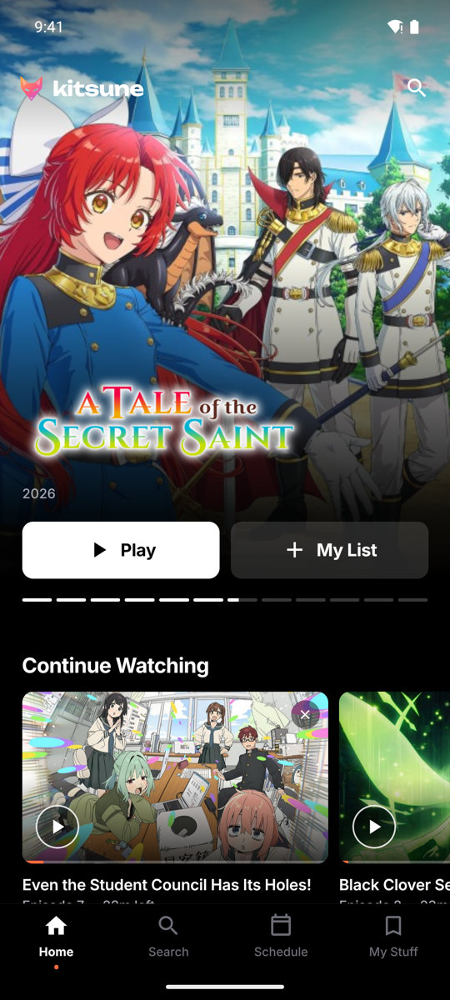<br><sub><b>Home</b></sub></td>
    <td align="center">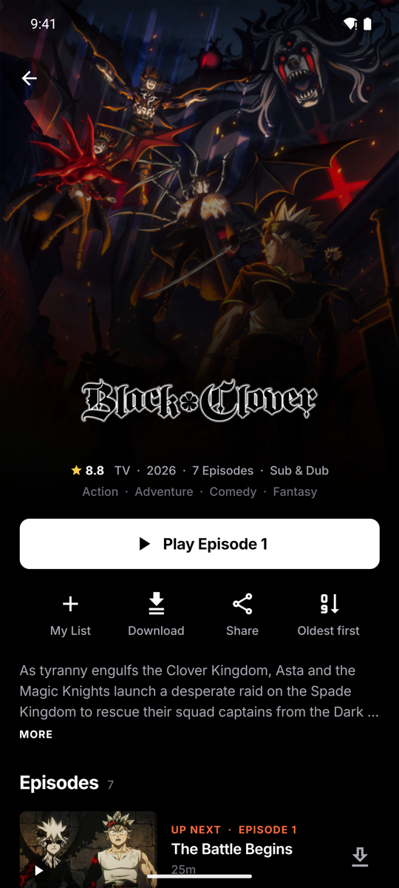<br><sub><b>Aoashi S2</b></sub></td>
    <td align="center">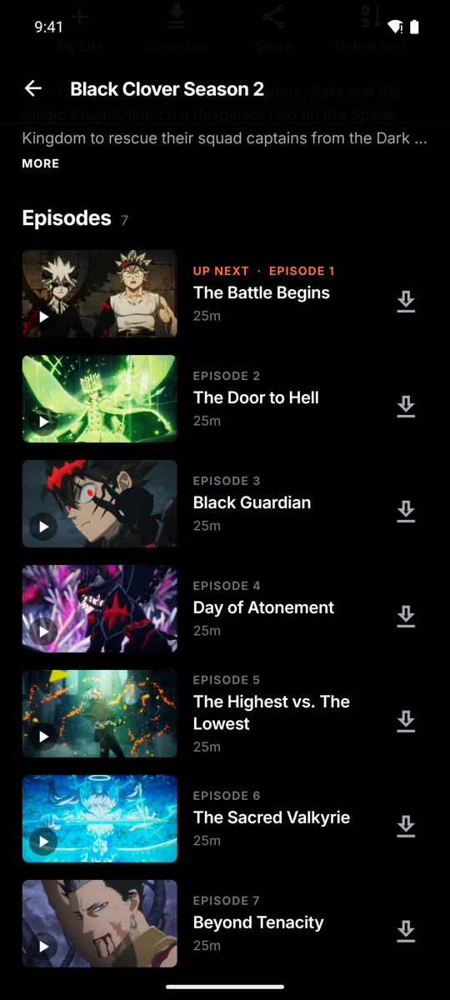<br><sub><b>Episodes</b></sub></td>
    <td align="center"><br><sub><b>Top 10</b></sub></td>
  </tr>
  <tr>
    <td align="center"><br><sub><b>Search</b></sub></td>
    <td align="center"><br><sub><b>Schedule</b></sub></td>
    <td align="center"><br><sub><b>My Stuff</b></sub></td>
    <td align="center" valign="middle"><sub>Ad-free.<br>No popups.<br>No redirects.<br>Just the show.</sub></td>
  </tr>
</table>

<p align="center">
  <br>
  <sub><b>The player:</b> just the video, in Kitsune's own native player, with skip intro, subtitles, quality, audio language and speed a tap away.</sub>
</p>

<h3 align="center">On the big screen</h3>

<table align="center">
  <tr>
    <td align="center">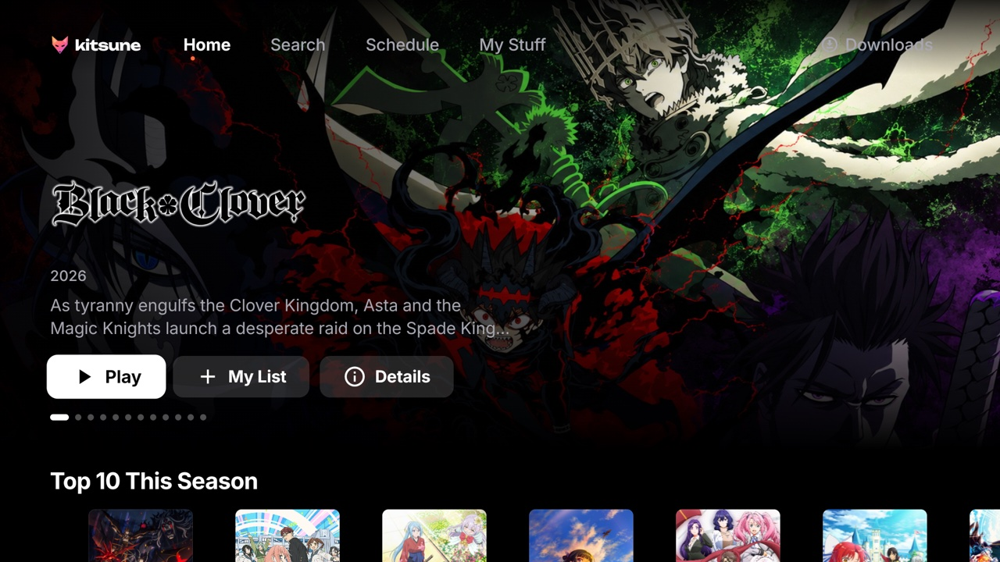<br><sub><b>Android TV / Google TV</b></sub></td>
    <td align="center">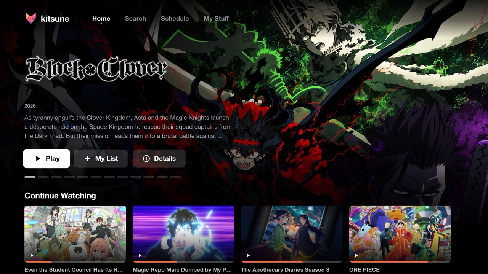<br><sub><b>Samsung TV (Tizen)</b></sub></td>
  </tr>
</table>

<p align="center"><sub>Same app, built for the remote. <a href="#android-tv-and-google-tv">Android TV</a> · <a href="#samsung-tv">Samsung TV</a></sub></p>

## Why Kitsune

Anime sites have the shows. What they don't have is an app that respects your time: no popups, no fake download buttons, no new tabs opening themselves, no waiting around for the video. Kitsune gives you a clean, cinematic UI over miruro.cx's catalog and plays every episode in its own native player from miruro.cx's streams. No website is ever loaded to play a video, so there's nothing to show you ads.

No accounts. No analytics. No trackers. Your list, history and downloads stay on your device.

## Features

| | |
| --- | --- |
| 🎬 **Cinematic home** | Full-bleed hero with a slow Ken Burns push, title art, story-style progress, Top 10, new episodes, seasonal, trending |
| ⚡ **Quick play** | While you read a show's page, the up-next episode's streams are looked up in the background, so Play starts fast |
| 🛡️ **Zero ads** | Episodes play in Kitsune's own native player from miruro.cx's streams. No web page, so no ads, popups or redirects |
| ⏭️ **Skip intro** | Skip the opening or ending with one tap (Up on a TV remote), sub or dub, and subtitles in your language |
| ⚙️ **Player settings** | Quality (Auto or locked to 1080p, 720p…), audio language, sub or dub, captions, caption size and background, playback speed |
| ⬇️ **Downloads** | Save single episodes or whole seasons (sub or dub, your quality) and watch them with no connection. They keep going with Kitsune in the background, with progress in a notification. My Stuff → Downloads |
| 🔔 **New episode alerts** | A notification when a show in My List (or one you're watching) gets a new episode. My Stuff → Notifications |
| ⏯️ **Pick up anywhere** | Progress saved per episode, Continue Watching on Home and My Stuff, auto-resume, next episode follows along |
| 📺 **Player-only view** | Just the video, full screen, landscape, immersive, screen stays awake. Fill or fit the screen with one tap |
| 🔎 **Search & categories** | Live search across English and Japanese titles, browse by genre, popular this week |
| 📅 **Schedule** | A weekly TV guide with air times, starting on today |
| 🔖 **My Stuff** | My List, watch history (swipe to remove), and how many hours you've put in |
| 🔄 **In-app updates** | New GitHub releases show up in the app: one tap downloads, checks and installs them, and your list and history stay |
| 📺 **On your TV** | The same APK runs on Android TV and Google TV with a 10-foot UI made for the remote; Samsung TVs get it through TizenBrew |
| 🪶 **Light** | ~55 MB APK for phones and TVs, R8-shrunk, cached catalog for instant cold starts |

## Install

1. Grab `Kitsune-vX.Y.Z.apk` from the [latest release](https://github.com/divitcr7/Kitsune/releases/latest).
2. Open it on your phone and allow **Install unknown apps** when Android asks.
3. Optional: check the file against the `.sha256` attached to the release.

```sh
shasum -a 256 Kitsune-v1.0.0.apk
```

Every release is signed with the same key, so updates install over the top and keep your list and history.

**Safe to install.** Kitsune passes **Google Play Protect**: Android scans the APK when you install it and says *"This app looks safe"*. No ads, no trackers, and only the permissions it needs (notifications, downloads in the background, installing its own updates). The whole source is right here to read. It's built and signed by a real person, from this repo.

<p align="center">
  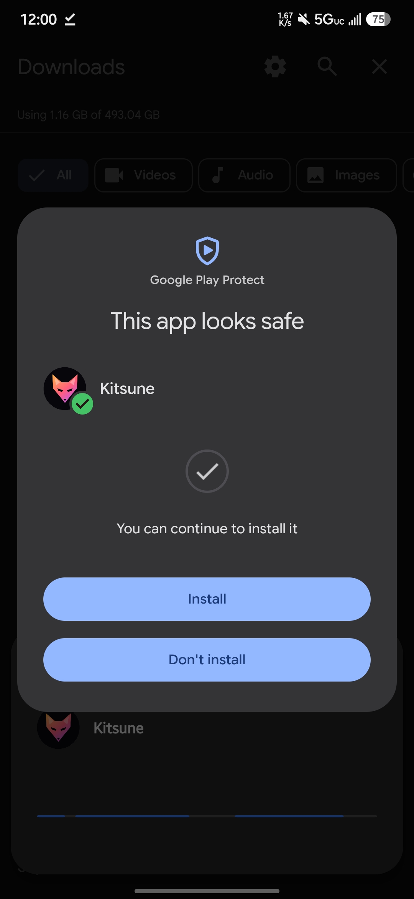<br>
  <sub>Installing Kitsune: Google Play Protect checks it and finds nothing wrong.</sub>
</p>

**Updates.** From v1.0.1 on, Kitsune checks this repo's latest release every few hours. When there's a newer one, it shows a sheet with the release notes and an **Update now** button: it downloads the APK, checks it against the release's SHA-256, and opens Android's installer. The first time, Android asks you to allow installs from Kitsune. (Android doesn't let sideloaded apps update silently, so it's one tap rather than none.) You can also check by hand in **My Stuff → Check for updates**.

## Android TV and Google TV

The APK above is the TV app too: one download for phones and TVs. On a TV it opens Kitsune's 10-foot interface (a top menu, shelves you move through with the remote, the player's own on-screen controls) and shows up on the home screen with its banner.

<table align="center">
  <tr>
    <td align="center">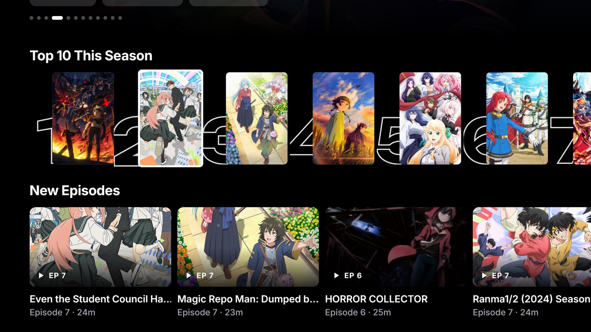<br><sub><b>Shelves</b></sub></td>
    <td align="center">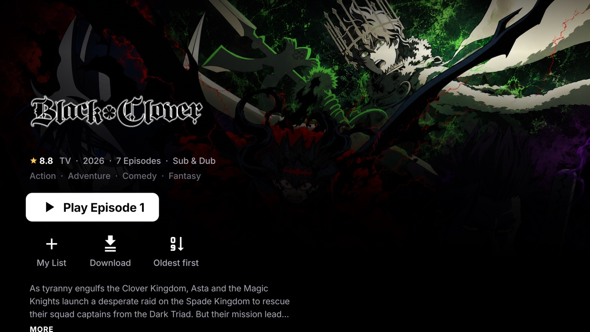<br><sub><b>Show page</b></sub></td>
  </tr>
  <tr>
    <td align="center">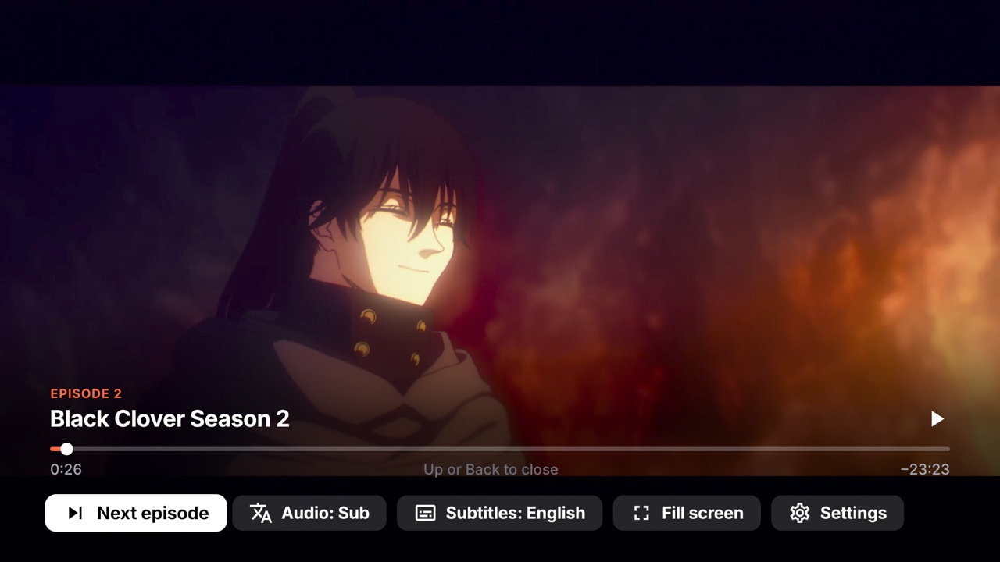<br><sub><b>Player controls</b></sub></td>
    <td align="center">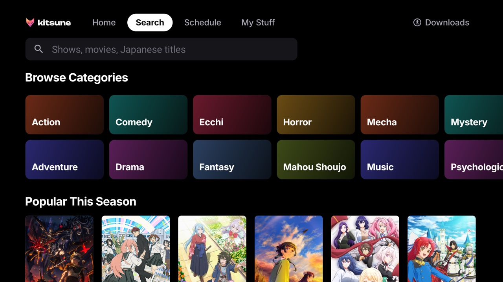<br><sub><b>Search</b></sub></td>
  </tr>
</table>

1. On the TV, install **Downloader** (by AFTVnews) from the Play Store, or copy the APK over USB or `adb install`.
2. Open `https://github.com/divitcr7/Kitsune/releases/latest` in Downloader, get `Kitsune-vX.Y.Z.apk`, and allow **Install unknown apps** for Downloader when the TV asks.
3. Kitsune appears in your apps. Updates work like on the phone: the app offers new releases and opens the system installer.

| Remote | Browsing | Watching |
| --- | --- | --- |
| ◀ ▶ ▲ ▼ | Move around. ◀ on Play / ▶ on Details flips the billboard | ◀ ▶ seek 10 s (keep pressing: 30 s, then 60 s; hold to scrub) · ▲ show the controls · ▼ more options |
| OK | Select (hold: open the show) | Play / pause |
| Back | Back a screen; from a section, Home; on Home, leave | Close the options row, then the player |
| ⏯ ⏪ ⏩ ⏮ ⏭ ⏹ | | Play/pause, seek, previous/next episode, stop |

▼ while watching opens **Next episode**, **Audio** (sub or dub), **Subtitles**, **Fill / Fit** and **Settings** (quality, audio language, captions, caption size, speed). ▲ skips the opening or ending while the pill is showing. Downloads and new-episode alerts work on Android TV too.

## Samsung TV

Samsung TVs (Tizen) get Kitsune as a [TizenBrew](https://github.com/reisxd/TizenBrew) module, since Samsung's store doesn't take unofficial clients: install TizenBrew once with Developer Mode, then add the module [`@divit7/kitsune-tizen`](https://www.npmjs.com/package/@divit7/kitsune-tizen). Same look and the same remote controls. Step-by-step install, supported TVs and troubleshooting: **[tv/tizen/README.md](tv/tizen/README.md)**.

<table align="center">
  <tr>
    <td align="center"><br><sub><b>Shelves</b></sub></td>
    <td align="center">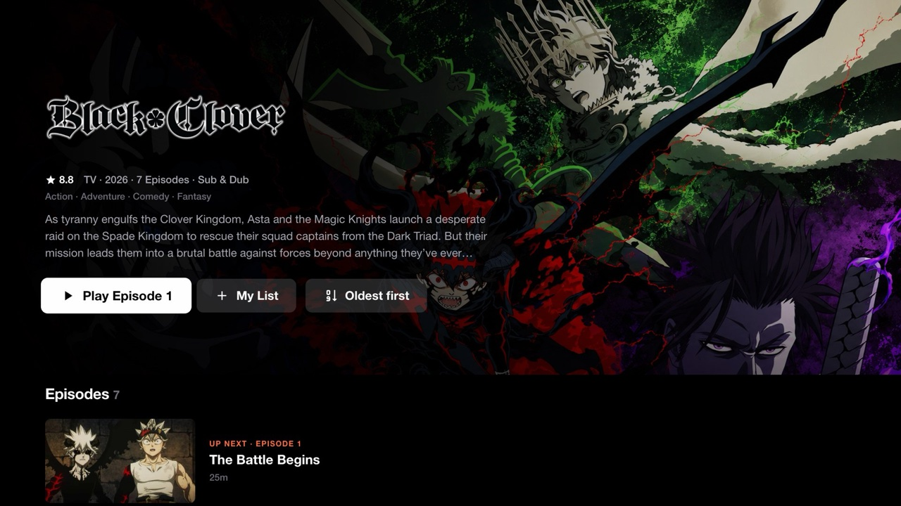<br><sub><b>Show page</b></sub></td>
  </tr>
  <tr>
    <td align="center">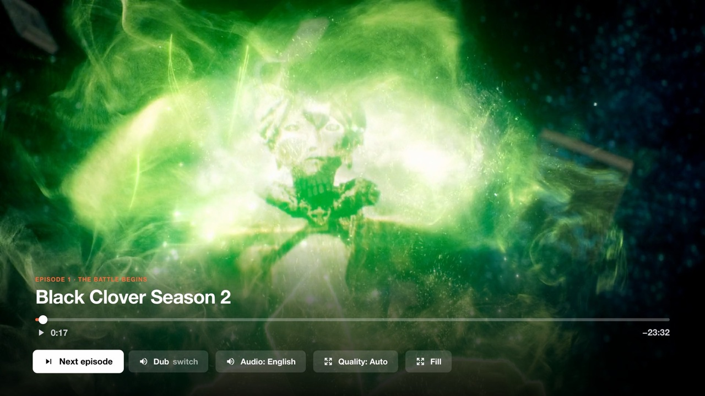<br><sub><b>Player controls</b></sub></td>
    <td align="center">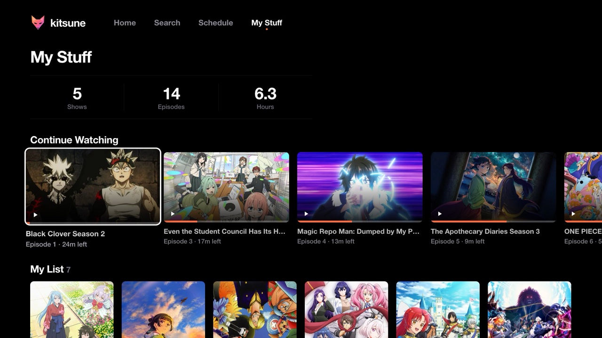<br><sub><b>My Stuff</b></sub></td>
  </tr>
</table>

## Troubleshooting

**A Cloudflare page ("Just a moment…" or "Verify you are human") before the episode.** miruro.cx has Cloudflare check connections now and then. Kitsune shows the check as it is: most of the time it passes by itself after a few seconds, sometimes it needs a tap on the box (on a TV: OK on the remote). Then the episode plays. Kitsune never opens your browser by itself.

**"From the old catalog" in My Stuff.** Shows saved before 1.3 (when the catalog came from anime.nexus) are moved onto miruro.cx automatically. The few Kitsune can't be sure about are listed there: tap one to search for it, or remove it.

**"Episode N isn't on miruro.cx yet".** miruro.cx hasn't got that episode yet. New episodes usually appear within a few hours of airing.

**"No working stream for this episode".** Kitsune tried every stream miruro.cx offered and none started. That's usually temporary: wait a minute and tap **Try again**. If the other language has streams, **Play the dub** / **Play subbed** is right there.

**"miruro.cx didn't let Kitsune through".** Cloudflare's check kept coming back. Give it a moment and tap **Try again**.

**"Couldn't load the … subtitles".** None of the places the subtitle file can come from answered. Pick another language under Settings → Captions, or try again later.

**Downloads in the background.** Downloads keep going when you leave Kitsune or turn the screen off, with a "Downloading" notification showing progress (allow notifications to see it). If Android closes Kitsune anyway (or after a few hours on Android 15), open it again and the queue carries on from the last saved piece; nothing is downloaded twice.

**No new-episode notifications.** Allow notifications for Kitsune, and check My Stuff → Notifications is on. Alerts are set up from miruro's schedule whenever Kitsune is opened, a week ahead, so open it at least once a week to keep them coming.

**A download says "Not enough free space" or "This stream can't be saved".** Free some space and tap it to try again. A stream miruro.cx serves encrypted can't be saved; streaming it still works.

**No volume boost or Anime4K upscaling.** Those need native code the video player doesn't expose, so Kitsune doesn't show options that wouldn't work.

**"Couldn't reach miruro.cx" or "miruro.cx answered with an error".** A connection problem or a hiccup on the site. Check your connection and tap **Try again**.

## How it works

```
 ┌───────────────────────────── Kitsune ─────────────────────────────┐
 │                                                                   │
 │  React Native UI ──► miruro.cx catalog API, asked from a hidden   │
 │   in-app browser tab on the site (robots.txt: none of its scripts)│
 │   home · search · schedule · show pages · episodes                │
 │                                                                   │
 │  Play ──► miruro.cx play API through the same tab                 │
 │       ──► episode streams ranked; native player (ExoPlayer) tries │
 │           them in turn until one plays                            │
 │       ──► Kitsune's own controls, subtitles and skip-intro on top │
 │                                                                   │
 │  Download ──► the same streams, saved piece by piece to the       │
 │               device; a foreground service keeps it going in the  │
 │               background; plays offline from the saved files      │
 │                                                                   │
 │  Alerts ──► miruro's airing schedule, read when Kitsune opens;    │
 │             the week's episodes notify at air time                │
 └───────────────────────────────────────────────────────────────────┘

 Android TV: the same app (React Native's TV fork), TV layouts when Platform.isTV.
 Samsung TV: a TizenBrew module with a Preact 10-foot UI (tv/tizen).
```

Kitsune never rehosts or decrypts video. It asks miruro.cx for an episode's streams the way the site's own player does and plays them natively, so none of the site's pages (or their ads) are ever loaded. Downloads stay on your device.

## Build it yourself

You need Node 24, a JDK 17+ and the Android SDK (`JAVA_HOME` and `ANDROID_HOME` set).

```sh
git clone https://github.com/divitcr7/Kitsune.git
cd Kitsune
npm ci
npm run typecheck      # TypeScript, the injected-script check and the playback checks (scripts/check-miruro.mjs)
npm run lint
npm run build:apk      # → dist/Kitsune-v<version>.apk (phones and Android TV)
npm run build:tizen    # → tv/tizen/dist/kitsune.js (the Samsung TV module)
```

React Native comes from [react-native-tvos](https://github.com/react-native-tvos/react-native-tvos), the community fork that adds TV focus and remote support (`package.json` maps `react-native` to it; Expo supports it). The one APK runs on phones and TVs: `@react-native-tvos/config-tv` adds the Android TV launcher entry and banner, and nothing in it is required, so phones install it as before.

For live development, `npx expo run:android` with a device or emulator attached (an **Android TV / Google TV** emulator image works for the TV layouts).

The `android/` folder is generated from `app.json` by `expo prebuild` and is not committed.

**Releasing an update** (so installed apps pick it up):

1. Bump `expo.version` **and** `expo.android.versionCode` in `app.json` (versionCode must go up every release, or Android refuses the update). Keep `package.json`'s version in step.
2. `npm run build:apk`. It writes `dist/Kitsune-vX.Y.Z.apk` and `dist/Kitsune-vX.Y.Z.apk.sha256`, signed with your release key.
3. Publish the release: `bash scripts/github-release.sh notes.md` (creates `vX.Y.Z` from `app.json`, attaches both files, uses your GitHub login). The notes are what the in-app update sheet shows.

Attach exactly one `.apk` to a release, named `Kitsune-vX.Y.Z.apk`. Phones and TVs share it, and v1.0.1 picks the first file ending in `.apk`, so anything else ending in `.apk` could be installed in its place. (From v1.1.0 the app only accepts that exact name.)

**Samsung TV module:** bump `version` (and `kitsuneNotes`, the line TVs show after updating) in `tv/tizen/package.json`, then `bash scripts/publish-tizen.sh <one-time code>`. It builds, publishes to npm and clears jsDelivr's cache, so TVs get the new version the next time TizenBrew starts. Don't make GitHub releases for it; if you want notes for it, mark them pre-release so `releases/latest` stays the APK.

**Signing.** Without a keystore the APK is signed with the debug key. To sign with your own release key, create `~/.kitsune/keystore.properties` (or point `KITSUNE_KEYSTORE_PROPERTIES` at one) with `storeFile`, `storePassword`, `keyAlias` and `keyPassword`. Keys stay outside the repo; `.gitignore` also blocks `*.jks`, `*.p12`, `*.key` and `.env*.local`.

## Project layout

| Path | What lives there |
| --- | --- |
| `src/app/` | Screens (Expo Router): `(tabs)/` Home, Search, Schedule, My Stuff; `show/[id]`, `genre/[id]`, `downloads` |
| `src/components/Player.tsx` | The native player (expo-video): finds the streams, tries them in turn, subtitles, skip intro, offline playback |
| `src/components/` | Hero, rails, cards, tab bar; `PhoneControls`, `PlayerOsd` (TV) and `PlayerSettings`; download button and sheet |
| `src/lib/miruro/` | miruro.cx: API (through a hidden in-app browser tab), show matching via AniList, stream ranking, subtitles |
| `src/lib/downloads/` | Download queue, engine and files; `background.ts` with `modules/kitsune-downloads` (the foreground service) |
| `src/lib/notify.ts` | New-episode and finished-download notifications |
| `src/lib/hls.ts`, `subtitles.ts` | HLS playlists (quality lock, downloads); VTT, SRT and ASS subtitles |
| `src/lib/catalog.ts`, `api.ts` | miruro.cx catalog: home rails, search, genres, schedule, shows and episodes |
| `src/lib/updates.ts` | In-app updates from GitHub releases: check, download, verify, install |
| `src/lib/tv.ts` | `isTV`, 10-foot sizing and overscan margins for the TV layouts |
| `src/lib/store.ts` | My List, history, progress and player preferences (persisted on device) |
| `src/lib/queries.ts` | TanStack Query definitions, with an on-disk cache for the home rails |
| `src/theme/tokens.ts` | Colours, type, radii, motion |
| `tv/tizen/` | The Samsung TV module (TizenBrew): its own README, build and a no-network test harness |
| `scripts/` | APK build and signing, GitHub release, script and playback checks |

## Tech

[Expo SDK 58](https://expo.dev) · [React Native 0.88](https://reactnative.dev) ([TV fork](https://github.com/react-native-tvos/react-native-tvos)) · [Expo Router](https://docs.expo.dev/router/introduction/) · [expo-video](https://docs.expo.dev/versions/latest/sdk/video/) (ExoPlayer) · [expo-file-system](https://docs.expo.dev/versions/latest/sdk/filesystem/) · [expo-notifications](https://docs.expo.dev/versions/latest/sdk/notifications/) · [Reanimated 4](https://docs.swmansion.com/react-native-reanimated/) · [React Compiler](https://react.dev/learn/react-compiler) · [TanStack Query](https://tanstack.com/query) · [Zustand](https://zustand.docs.pmnd.rs) · [expo-image](https://docs.expo.dev/versions/latest/sdk/image/) · [react-native-webview](https://github.com/react-native-webview/react-native-webview) · [fflate](https://github.com/101arrowz/fflate) · TypeScript (strict)

## Credits

Kitsune stands on a lot of great work:

- **[miruro.cx](https://www.miruro.cx)** for the catalog, streams, subtitles, schedule and skip times. Kitsune is an unofficial app and isn't affiliated with or endorsed by miruro.cx. Artwork comes from AniList and TMDB through miruro.
- **[Expo](https://expo.dev)** and **[React Native](https://reactnative.dev)**, plus **[Software Mansion](https://swmansion.com)** for Reanimated, Gesture Handler, Screens and react-native-svg.
- **[TanStack Query](https://tanstack.com/query)**, **[Zustand](https://github.com/pmndrs/zustand)** and **[react-native-webview](https://github.com/react-native-webview/react-native-webview)**.
- **[react-native-tvos](https://github.com/react-native-tvos/react-native-tvos)** for TV focus and remote support, **[TizenBrew](https://github.com/reisxd/TizenBrew)** by reisxd for making Samsung TVs possible, and **[Preact](https://preactjs.com)**.
- **[Material Design Icons](https://pictogrammers.com/library/mdi/)** by Pictogrammers (Apache 2.0), via `@expo/vector-icons`.
- **[Inter](https://rsms.me/inter/)** by Rasmus Andersson and **[Unbounded](https://unbounded.polkadot.network)**, both under the [SIL Open Font License 1.1](assets/fonts/OFL.txt).
- Screenshots feature **Aoashi Season 2**. *Aoashi* © Yūgo Kobayashi / Shogakukan and its licensors. Artwork appears only to show the app in use.
- TV screenshots show titles from the catalog (*The Exiled Heavy Knight Knows How to Game the System*, *Frieren*, *Black Clover* and others); artwork belongs to its owners and appears only to show the app in use. The Android TV shots come from a Google TV emulator; the Samsung shots are the TV module rendering live catalog data at 1920×1080 in its test page. The player shots show the on-screen controls over an episode still.

## Disclaimer

Kitsune doesn't host, upload or rehost any content. Shows and episodes are loaded from miruro.cx, the same as opening the site in a browser. It's a personal, non-commercial project. If you love a show, support the official release.

## Say hi

Made by Divit. Bugs, ideas, or just want to talk anime?

- GitHub: [divitcr7](https://github.com/divitcr7) (issues and PRs welcome)
- Email: [divit.p09@gmail.com](mailto:divit.p09@gmail.com)

If Kitsune made your watch nights better, a ⭐ on the repo means a lot.

## License

[MIT](LICENSE). Fonts are under the [SIL OFL 1.1](assets/fonts/OFL.txt).
