<p align="center">
  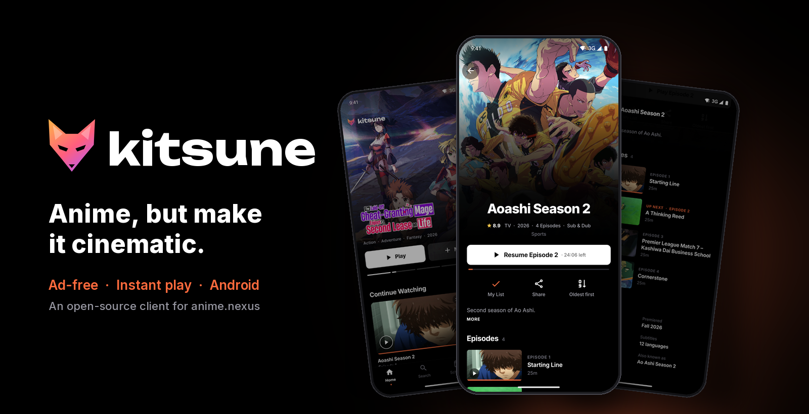
</p>

<h1 align="center">Kitsune</h1>

<p align="center">
  <b>Anime, but make it cinematic.</b><br>
  A fast, ad-free client for <a href="https://anime.nexus">anime.nexus</a> on Android phones, Android TV and Samsung TVs, built to feel like Apple TV, Max or Paramount+.
</p>

<p align="center">
  <a href="https://github.com/divitcr7/Kitsune/releases/latest"></a>
  <a href="https://github.com/divitcr7/Kitsune/releases"></a>
  <a href="https://github.com/divitcr7/Kitsune/actions/workflows/ci.yml"></a>
  <a href="LICENSE"></a>
</p>

<p align="center">
  
  
  
  
  
  
</p>

<p align="center">
  <a href="https://github.com/divitcr7/Kitsune/releases/latest"><b>⬇ Download the APK</b></a>
  &nbsp;·&nbsp; <a href="#android-tv-and-google-tv">Android TV</a>
  &nbsp;·&nbsp; <a href="#samsung-tv">Samsung TV</a>
  &nbsp;·&nbsp; <a href="#features">Features</a>
  &nbsp;·&nbsp; <a href="#how-it-works">How it works</a>
  &nbsp;·&nbsp; <a href="#build-it-yourself">Build</a>
  &nbsp;·&nbsp; <a href="#credits">Credits</a>
</p>

<br>

<table align="center">
  <tr>
    <td align="center">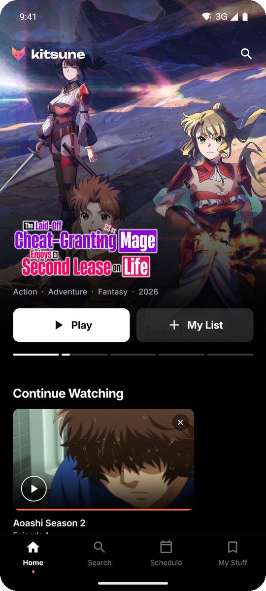<br><sub><b>Home</b></sub></td>
    <td align="center">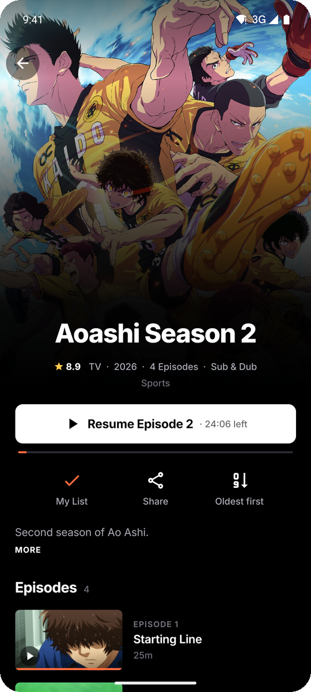<br><sub><b>Aoashi S2</b></sub></td>
    <td align="center">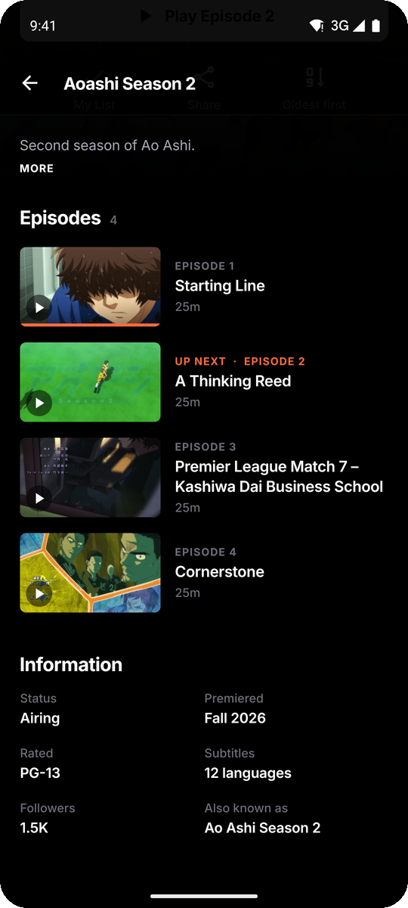<br><sub><b>Episodes</b></sub></td>
    <td align="center">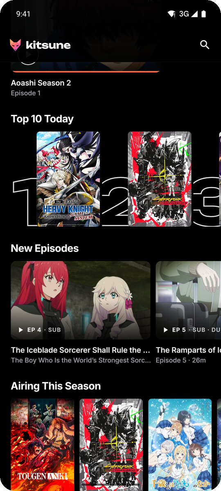<br><sub><b>Top 10</b></sub></td>
  </tr>
  <tr>
    <td align="center">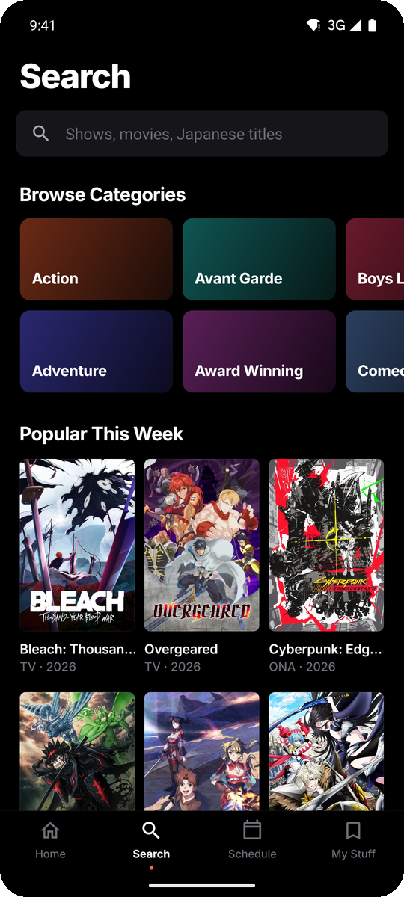<br><sub><b>Search</b></sub></td>
    <td align="center">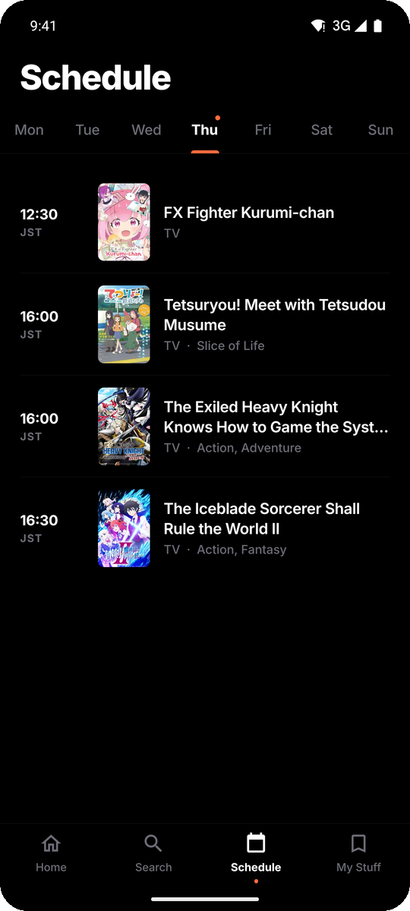<br><sub><b>Schedule</b></sub></td>
    <td align="center">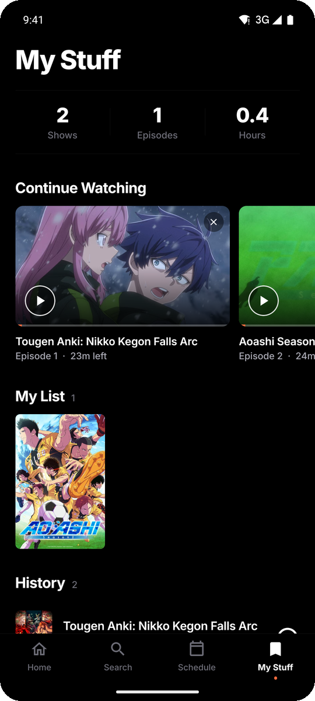<br><sub><b>My Stuff</b></sub></td>
    <td align="center" valign="middle"><sub>Ad-free.<br>No popups.<br>No redirects.<br>Just the show.</sub></td>
  </tr>
</table>

<p align="center">
  <br>
  <sub><b>The player:</b> just the video. Aoashi S2, episode 2, playing about a second after tapping Play (it preloaded while the show page was open).</sub>
</p>

<h3 align="center">On the big screen</h3>

<table align="center">
  <tr>
    <td align="center">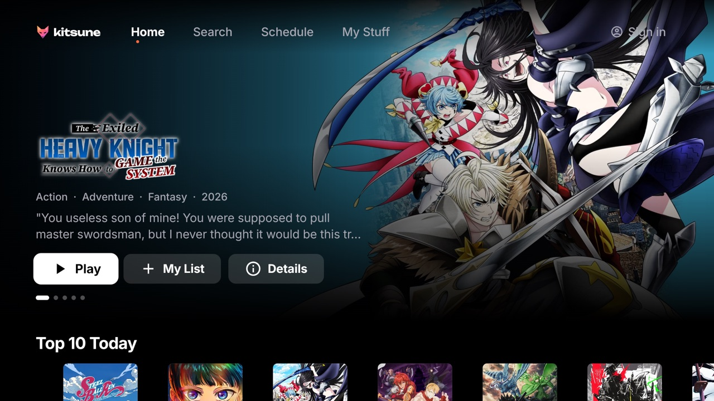<br><sub><b>Android TV / Google TV</b></sub></td>
    <td align="center">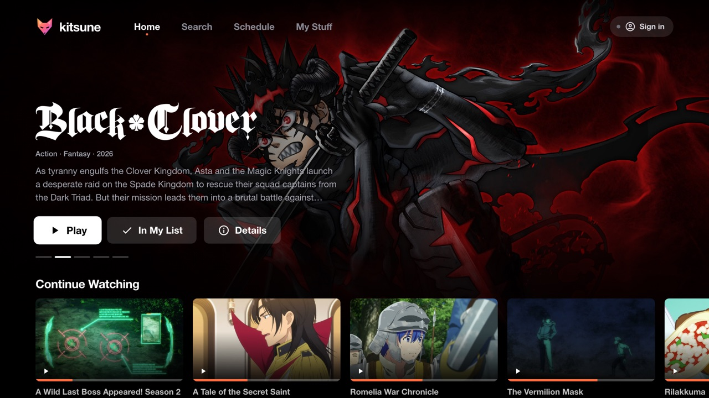<br><sub><b>Samsung TV (Tizen)</b></sub></td>
  </tr>
</table>

<p align="center"><sub>Same app, built for the remote. <a href="#android-tv-and-google-tv">Android TV</a> · <a href="#samsung-tv">Samsung TV</a></sub></p>

## Why Kitsune

The site has the catalog. What it doesn't have is an app that respects your time: no popups, no fake download buttons, no new tabs opening themselves, no waiting around for the video. Kitsune puts a clean, cinematic UI on top of the anime.nexus catalog and plays episodes in the site's own player with all the junk stripped out.

No accounts. No analytics. No trackers. Your list and history stay on your phone.

## Features

| | |
| --- | --- |
| 🎬 **Cinematic home** | Full-bleed hero with a slow Ken Burns push, title art, story-style progress, Top 10, new episodes, seasonal, trending |
| ⚡ **Near-instant play** | While you read a show's page, the up-next episode quietly loads in the background, so Play just plays |
| 🛡️ **Zero popups** | Ad scripts, iframes, popups and off-site redirects are blocked before they load (allowlist, not a blocklist) |
| ⏯️ **Pick up anywhere** | Progress saved per episode, Continue Watching on Home and My Stuff, auto-resume, next episode follows along |
| 📺 **Player-only view** | Just the video, full screen, landscape, immersive, screen stays awake. Pinch to fill the screen |
| 🔎 **Search & categories** | Live search across English and Japanese titles, browse by genre, popular this week |
| 📅 **Schedule** | A weekly TV guide with air times, starting on today |
| 🔖 **My Stuff** | My List, watch history (swipe to remove), and how many hours you've put in |
| 🔄 **In-app updates** | New GitHub releases show up in the app: one tap downloads, checks and installs them, and your list and history stay |
| 🔐 **anime.nexus sign-in** | Sign in once (My Stuff → anime.nexus account) and the player streams as you, with no guest limits |
| 📺 **On your TV** | The same APK runs on Android TV and Google TV with a 10-foot UI made for the remote; Samsung TVs get it through TizenBrew |
| 🪶 **Light** | ~35 MB arm64 APK, R8-shrunk, cached catalog for instant cold starts |

## Install

1. Grab `Kitsune-vX.Y.Z.apk` from the [latest release](https://github.com/divitcr7/Kitsune/releases/latest).
2. Open it on your phone and allow **Install unknown apps** when Android asks.
3. Optional: check the file against the `.sha256` attached to the release.

```sh
shasum -a 256 Kitsune-v1.0.0.apk
```

Every release is signed with the same key, so updates install over the top and keep your list and history.

**Updates.** From v1.0.1 on, Kitsune checks this repo's latest release every few hours. When there's a newer one, it shows a sheet with the release notes and an **Update now** button: it downloads the APK, checks it against the release's SHA-256, and opens Android's installer. The first time, Android asks you to allow installs from Kitsune. (Android doesn't let sideloaded apps update silently, so it's one tap rather than none.) You can also check by hand in **My Stuff → Check for updates**.

## Android TV and Google TV

The APK above is the TV app too: one download for phones and TVs. On a TV it opens Kitsune's 10-foot interface (a top menu, shelves you move through with the remote, the player's own on-screen controls) and shows up on the home screen with its banner.

<table align="center">
  <tr>
    <td align="center">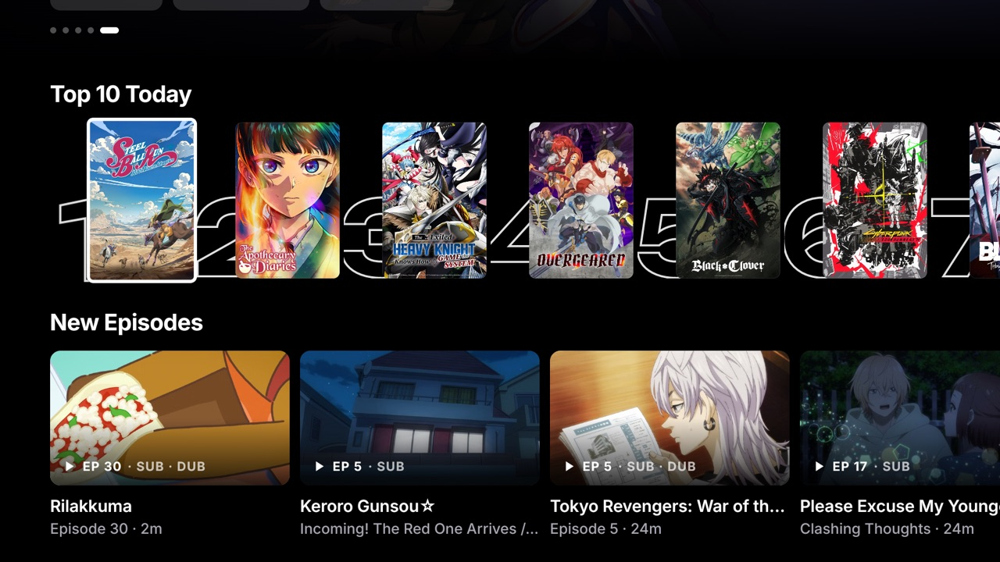<br><sub><b>Shelves</b></sub></td>
    <td align="center">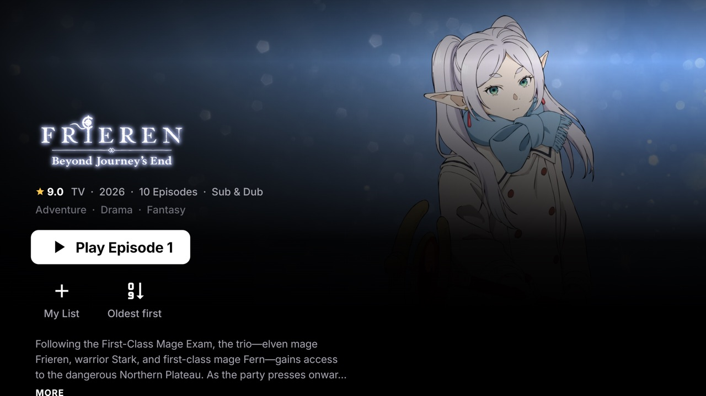<br><sub><b>Show page</b></sub></td>
  </tr>
  <tr>
    <td align="center">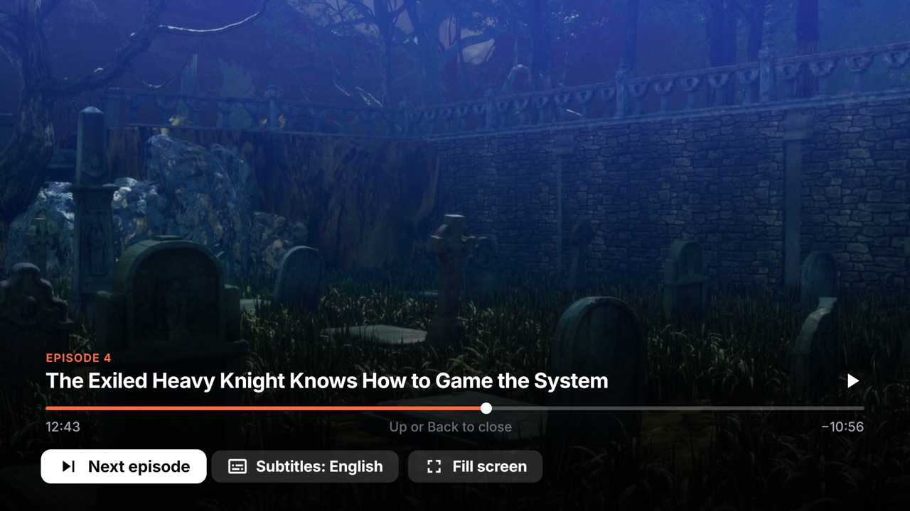<br><sub><b>Player controls</b></sub></td>
    <td align="center">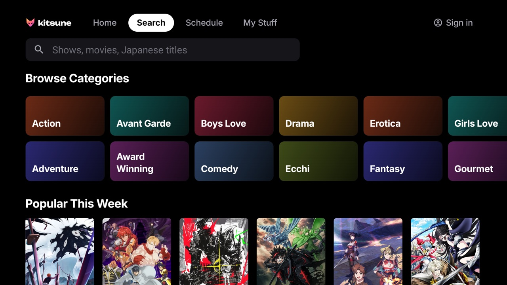<br><sub><b>Search</b></sub></td>
  </tr>
</table>

1. On the TV, install **Downloader** (by AFTVnews) from the Play Store, or copy the APK over USB or `adb install`.
2. Open `https://github.com/divitcr7/Kitsune/releases/latest` in Downloader, get `Kitsune-vX.Y.Z.apk`, and allow **Install unknown apps** for Downloader when the TV asks.
3. Kitsune appears in your apps. Updates work like on the phone: the app offers new releases and opens the system installer.

| Remote | Browsing | Watching |
| --- | --- | --- |
| ◀ ▶ ▲ ▼ | Move around. ◀ on Play / ▶ on Details flips the billboard | ◀ ▶ seek 10 s (keep pressing: 30 s, then 60 s; hold to scrub) · ▲ show the controls · ▼ more options |
| OK | Select (hold: open the show) | Play / pause |
| Back | Back a screen; from a section, Home; on Home, leave | Close the options row, then the player |
| ⏯ ⏪ ⏩ ⏮ ⏭ ⏹ | | Play/pause, seek, previous/next episode, stop |

▼ while watching opens **Next episode**, **Audio** (when there's more than one language), **Subtitles** and **Fill / Fit**. Sign in from **Sign in** at the top right: Kitsune shows its own email and password form (the TV keyboard opens on OK) and submits anime.nexus's real form for you; **Use the web page** shows the site's own page instead. Your password only goes to anime.nexus and isn't saved.

## Samsung TV

Samsung TVs (Tizen) get Kitsune as a [TizenBrew](https://github.com/reisxd/TizenBrew) module. A normal Samsung app can't run Kitsune's guard script inside anime.nexus's own player, and Samsung's store doesn't take unofficial clients, so it goes through TizenBrew: install it once with Developer Mode, then add the module [`@divit7/kitsune-tizen`](https://www.npmjs.com/package/@divit7/kitsune-tizen). Same look, same remote controls, same ad-free player. Step-by-step install, supported TVs and troubleshooting: **[tv/tizen/README.md](tv/tizen/README.md)**.

<table align="center">
  <tr>
    <td align="center">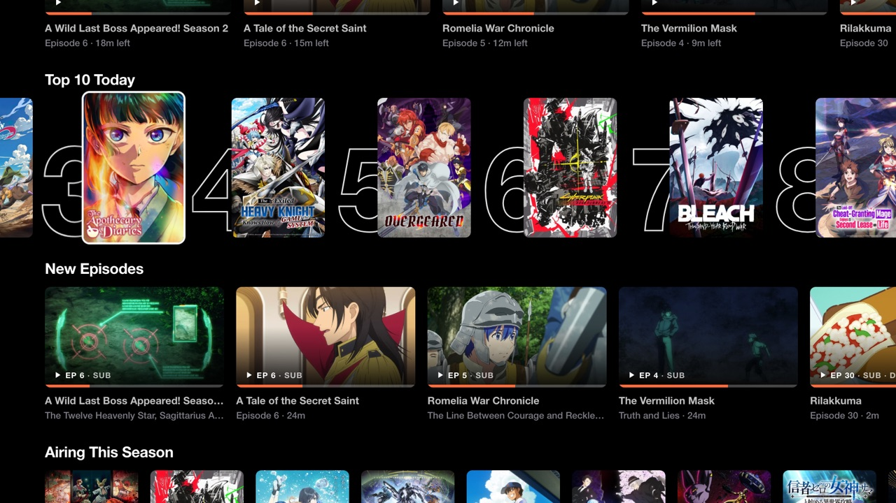<br><sub><b>Shelves</b></sub></td>
    <td align="center">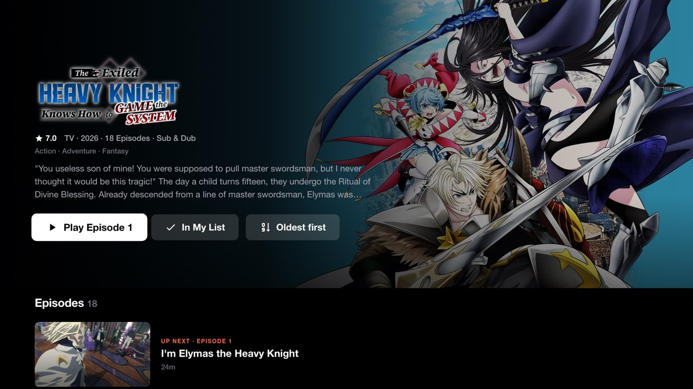<br><sub><b>Show page</b></sub></td>
  </tr>
  <tr>
    <td align="center">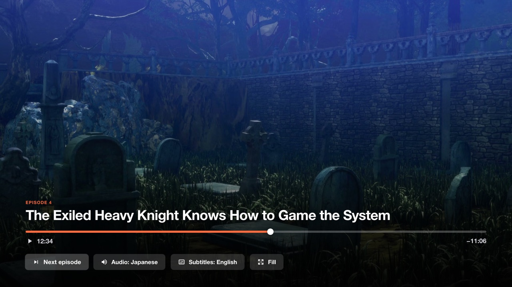<br><sub><b>Player controls</b></sub></td>
    <td align="center">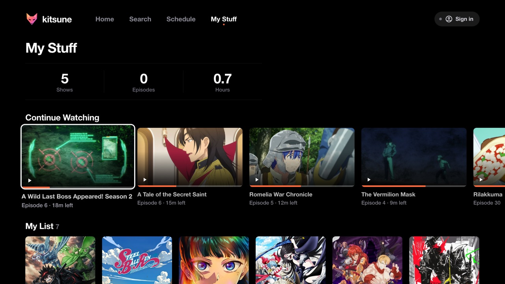<br><sub><b>My Stuff</b></sub></td>
  </tr>
</table>

## Troubleshooting

**"Sign in to continue this streaming session" or "Too many new guest sessions".** That's anime.nexus limiting guest streams. Kitsune shows a screen with **Sign in** and **Try again**. Signing in to your anime.nexus account (My Stuff → anime.nexus account) lifts the guest limits, and playback picks up where it stopped. Use your email and password: Google blocks its sign-in inside apps, so if you signed up with Google, add a password on anime.nexus in a browser first.

**"This episode won't start right now".** anime.nexus refused the stream for a moment, usually a short rate limit. Wait a minute and tap **Try again**. Kitsune also pauses its background preloading for a while so it doesn't make things worse.

**A Cloudflare page ("Just a moment…" or "Verify you are human") before the episode.** anime.nexus has Cloudflare check connections now and then. The check runs inside Kitsune's player, untouched: most of the time it passes by itself after a few seconds, sometimes it needs a tap on the box (on a TV: OK on the remote). Then the episode plays in the app. Kitsune never opens your browser by itself.

**"anime.nexus didn't open this episode".** anime.nexus answered with an error page instead of the episode. That's usually temporary: wait a moment and tap **Try again**. On a phone you can also choose **Open in browser** to watch it on the site.

**A "Verify you are human" box over the video.** That's Cloudflare, on anime.nexus's behalf. Tap it and playback continues. On a TV, Kitsune puts the remote's focus on it: press OK (Back leaves the player).

## How it works

```
 ┌───────────────────────────── Kitsune ─────────────────────────────┐
 │                                                                   │
 │  React Native UI ──► anime.nexus catalog API (public JSON)        │
 │   home · search · schedule · show pages · images (AVIF via CDN)   │
 │                                                                   │
 │  Player ──► WebView on the site's own /watch page                 │
 │             + injected guard script:                              │
 │               · allowlist for scripts / iframes / navigation      │
 │               · window.open, document.write, alerts → no-ops      │
 │               · pins the video player full screen, hides the rest │
 │               · reports progress back for resume                  │
 │               · TV: takes remote commands, reports for the OSD    │
 └───────────────────────────────────────────────────────────────────┘

 Android TV: the same app (React Native's TV fork), TV layouts when Platform.isTV.
 Samsung TV: a TizenBrew module runs the same guard script in anime.nexus's page,
             with a Preact 10-foot UI on the site's origin (tv/tizen).
```

Kitsune never downloads, rehosts or decrypts video. Streams play inside the site's own player, exactly as they would in a browser, minus the ads and popups.

## Build it yourself

You need Node 24, a JDK 17+ and the Android SDK (`JAVA_HOME` and `ANDROID_HOME` set).

```sh
git clone https://github.com/divitcr7/Kitsune.git
cd Kitsune
npm ci
npm run typecheck      # TypeScript + a parse check of the injected player script
npm run lint
npm run build:apk      # → dist/Kitsune-v<version>.apk (phones and Android TV)
npm run build:tizen    # → tv/tizen/dist/kitsune.js (the Samsung TV module)
```

React Native comes from [react-native-tvos](https://github.com/react-native-tvos/react-native-tvos), the community fork that adds TV focus and remote support (`package.json` maps `react-native` to it; Expo supports it). The one APK runs on phones and TVs: `@react-native-tvos/config-tv` adds the Android TV launcher entry and banner, and nothing in it is required, so phones install it as before.

For live development, `npx expo run:android` with a device or emulator attached (an **Android TV / Google TV** emulator image works for the TV layouts).

The `android/` folder is generated from `app.json` by `expo prebuild` and is not committed.

**Releasing an update** (so installed apps pick it up):

1. Bump `expo.version` **and** `expo.android.versionCode` in `app.json` (versionCode must go up every release, or Android refuses the update). Keep `package.json`'s version in step.
2. `npm run build:apk`. It writes `dist/Kitsune-vX.Y.Z.apk` and `dist/Kitsune-vX.Y.Z.apk.sha256`, signed with your release key.
3. Publish the release: `bash scripts/github-release.sh notes.md` (creates `vX.Y.Z` from `app.json`, attaches both files, uses your GitHub login). The notes are what the in-app update sheet shows.

Attach exactly one `.apk` to a release, named `Kitsune-vX.Y.Z.apk`. Phones and TVs share it, and v1.0.1 picks the first file ending in `.apk`, so anything else ending in `.apk` could be installed in its place. (From v1.1.0 the app only accepts that exact name.)

**Samsung TV module:** bump `version` (and `kitsuneNotes`, the line TVs show after updating) in `tv/tizen/package.json`, then `bash scripts/publish-tizen.sh <one-time code>`. It builds, publishes to npm and clears jsDelivr's cache, so TVs get the new version the next time TizenBrew starts. Don't make GitHub releases for it; if you want notes for it, mark them pre-release so `releases/latest` stays the APK.

**Signing.** Without a keystore the APK is signed with the debug key. To sign with your own release key, create `~/.kitsune/keystore.properties` (or point `KITSUNE_KEYSTORE_PROPERTIES` at one) with `storeFile`, `storePassword`, `keyAlias` and `keyPassword`. Keys stay outside the repo; `.gitignore` also blocks `*.jks`, `*.p12`, `*.key` and `.env*.local`.

## Project layout

| Path | What lives there |
| --- | --- |
| `src/app/` | Screens (Expo Router): `(tabs)/` Home, Search, Schedule, My Stuff; `show/[id]`, `genre/[id]` |
| `src/components/` | Hero, rails, poster and episode cards, tab bar, player host; `TvNav` and `PlayerOsd` (the TV's menu and player controls) |
| `src/lib/api.ts` | anime.nexus API client and types |
| `src/lib/inject.ts` | The script injected into the player page (blocking, player-only view, resume, progress) |
| `src/lib/player.ts` | The single app-wide player: open, preload (rate-limited), reveal, close, resume after sign-in |
| `src/lib/updates.ts` | In-app updates from GitHub releases: check, download, verify, install |
| `src/lib/tv.ts` | `isTV`, 10-foot sizing and overscan margins for the TV layouts |
| `tv/tizen/` | The Samsung TV module (TizenBrew): its own README, build and a no-network test harness |
| `src/app/account.tsx` | anime.nexus account screen (sign in, settings) behind the same ad guard as the player |
| `src/lib/store.ts` | My List, history and progress (persisted on device) |
| `src/lib/queries.ts` | TanStack Query definitions, with an on-disk cache for the home rails |
| `src/theme/tokens.ts` | Colours, type, radii, motion |
| `scripts/` | APK build + signing, player script check |

## Tech

[Expo SDK 58](https://expo.dev) · [React Native 0.88](https://reactnative.dev) ([TV fork](https://github.com/react-native-tvos/react-native-tvos)) · [Expo Router](https://docs.expo.dev/router/introduction/) · [Reanimated 4](https://docs.swmansion.com/react-native-reanimated/) · [React Compiler](https://react.dev/learn/react-compiler) · [TanStack Query](https://tanstack.com/query) · [Zustand](https://zustand.docs.pmnd.rs) · [expo-image](https://docs.expo.dev/versions/latest/sdk/image/) · [react-native-webview](https://github.com/react-native-webview/react-native-webview) · TypeScript (strict)

## Credits

Kitsune stands on a lot of great work:

- **[anime.nexus](https://anime.nexus)** for the catalog, artwork and player. Kitsune is an unofficial client and isn't affiliated with or endorsed by anime.nexus.
- **[Expo](https://expo.dev)** and **[React Native](https://reactnative.dev)**, plus **[Software Mansion](https://swmansion.com)** for Reanimated, Gesture Handler, Screens and react-native-svg.
- **[TanStack Query](https://tanstack.com/query)**, **[Zustand](https://github.com/pmndrs/zustand)** and **[react-native-webview](https://github.com/react-native-webview/react-native-webview)**.
- **[react-native-tvos](https://github.com/react-native-tvos/react-native-tvos)** for TV focus and remote support, **[TizenBrew](https://github.com/reisxd/TizenBrew)** by reisxd for making Samsung TVs possible, and **[Preact](https://preactjs.com)**.
- **[Material Design Icons](https://pictogrammers.com/library/mdi/)** by Pictogrammers (Apache 2.0), via `@expo/vector-icons`.
- **[Inter](https://rsms.me/inter/)** by Rasmus Andersson and **[Unbounded](https://unbounded.polkadot.network)**, both under the [SIL Open Font License 1.1](assets/fonts/OFL.txt).
- Screenshots feature **Aoashi Season 2**. *Aoashi* © Yūgo Kobayashi / Shogakukan and its licensors. Artwork appears only to show the app in use.
- TV screenshots show titles from the anime.nexus catalog (*The Exiled Heavy Knight Knows How to Game the System*, *Frieren*, *Black Clover* and others); artwork belongs to its owners and appears only to show the app in use. The Android TV shots come from a Google TV emulator; the Samsung shots are the TV module rendering live catalog data at 1920×1080 in its test page. The player shots show the on-screen controls over an episode still.

## Disclaimer

Kitsune doesn't host, upload or rehost any content. Everything you see and play is loaded from anime.nexus, the same as opening the site in a browser. It's a personal, non-commercial project. If you love a show, support the official release.

## Say hi

Made by Divit. Bugs, ideas, or just want to talk anime?

- GitHub: [divitcr7](https://github.com/divitcr7) (issues and PRs welcome)
- Email: [divit.p09@gmail.com](mailto:divit.p09@gmail.com)

If Kitsune made your watch nights better, a ⭐ on the repo means a lot.

## License

[MIT](LICENSE). Fonts are under the [SIL OFL 1.1](assets/fonts/OFL.txt).
