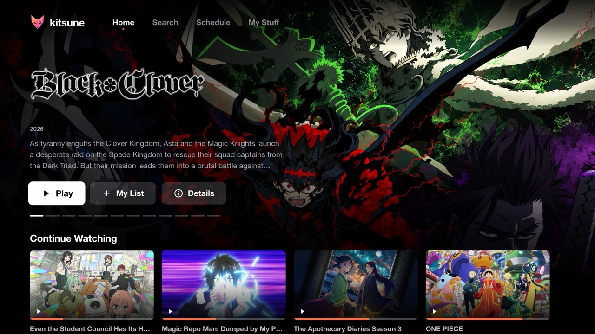

# Kitsune for Samsung TV

<p align="center"></p>

Kitsune on Samsung Smart TVs (Tizen): the same cinematic, ad-free anime app as the Android one, built for a TV remote, with everything (catalog and episodes) from [miruro.cx](https://www.miruro.cx) playing in Kitsune's own player. It's a [TizenBrew](https://github.com/reisxd/TizenBrew) module, published on npm as [`@divit7/kitsune-tizen`](https://www.npmjs.com/package/@divit7/kitsune-tizen); the phone and Android TV app is the APK on [Kitsune's releases](https://github.com/divitcr7/Kitsune/releases/latest).

> **Why TizenBrew?** miruro.cx only answers a real browser on its own site. TizenBrew is an open-source TV app that opens a website and runs a module's script in it, so Kitsune can live on a blank page of miruro.cx (its `robots.txt`, where none of the site's scripts or ads run) and use miruro's API from there like the site itself does. Samsung's app store isn't an option for an unofficial client like this, so installing TizenBrew once (in Developer Mode) is the way in.

## Install

You need the TV and a computer (Windows, macOS or Linux) on the same network. One time only:

1. **Developer Mode on the TV.** Open **Apps**, then press **1 2 3 4 5** on the remote (on some remotes, the on-screen number pad). Switch **Developer mode** on, enter your computer's IP address as **Host PC IP**, and restart the TV (hold the power button until it turns off and on again).
2. **Install TizenBrew** with [TizenBrew Installer](https://github.com/reisxd/TizenBrewInstaller/releases/latest) on your computer (on macOS or Linux you may need to `chmod +x` the download and run it from a terminal). Press **Install TizenBrew**. On 2023 and newer TVs (Tizen 7+) it asks you to sign in with a Samsung account, which it uses to make a certificate for your TV. Full instructions: [TizenBrew's guide](https://github.com/reisxd/TizenBrew/blob/main/docs/README.md).
3. **Point Developer Mode at the TV itself.** TizenBrew injects modules through the TV's own debugger and only does so when **Host PC IP** is `127.0.0.1`. Go back to **Apps → 1 2 3 4 5**, set it to `127.0.0.1` if it isn't already, and restart the TV.
4. **Add Kitsune.** Open TizenBrew on the TV, go to **Module Manager → Add**, choose **NPM**, and enter `@divit7/kitsune-tizen`. Kitsune appears in TizenBrew's list; open it from there. (TizenBrew's settings can also launch it automatically.)

Updates arrive by themselves: TizenBrew loads the newest published version of the module each time it starts.

## Supported TVs

Samsung TVs from **2019 on** (Tizen 5.0+) are the target. **2017–2018** sets (Tizen 3 and 4) are best effort: the bundle is compiled down to ES5 for their older Chromium, but TizenBrew itself and the TV's speed decide how well it runs. Anything TizenBrew supports, Kitsune should load on.

## Using it

| Remote | On Kitsune's screens | While watching |
| --- | --- | --- |
| ◀ ▶ ▲ ▼ | Move around | ◀ ▶ seek 10 s (keep pressing: 30 s, then 60 s) · ▲ skip the intro or credits (when the pill shows) · ▼ more options |
| OK | Select | Play / pause |
| Back (↩) | Back a screen; on a tab, up to the menu bar; then asks before leaving | Close the options row, otherwise back to where you were |
| ⏯ ▶ ⏸ | | Play / pause |
| ⏪ ⏩ | | Seek |
| ⏮ ⏭ | | Previous / next episode |
| ⏹ | | Back to the show |

▼ while watching opens a row with **Next episode**, **Sub / Dub** (when the episode has both), **Audio** (when the stream carries more than one language), **Subtitles** (language or off), **Quality** (Auto or a fixed resolution) and **Fill / Fit**. Kitsune remembers each choice for the next episode, and moves on to the next episode by itself at the end of one.

My List, history and progress are kept on the TV (in miruro.cx's storage in TizenBrew), separate from the phone app. Kitsune 0.1 kept them on anime.nexus, which this version no longer uses, so the TV starts with an empty list.

## Troubleshooting

- **TizenBrew says it can't launch in debug mode.** Developer Mode must be on with Host PC IP `127.0.0.1` (step 3). It switches off by itself on some TVs after a firmware update; turn it back on.
- **"Failed to load module".** The TV couldn't reach jsDelivr, which TizenBrew loads modules from. Check the connection and relaunch TizenBrew.
- **A "Verify you are human" page.** That's Cloudflare, on miruro.cx's behalf. Kitsune steps aside while it shows: press OK to tick the box, and Kitsune comes back once it's done.
- **"Can’t reach miruro.cx".** The TV is offline or miruro.cx is down. Try again in a moment.
- **"This episode won’t start right now".** None of miruro.cx's servers would play it just then (Kitsune tries each one). Wait a minute and choose Try again.
- **"Not out yet".** miruro.cx doesn't have that episode yet.

## How it works

TizenBrew relaunches itself in debug mode through the TV's local `sdb` port, attaches to its own window with the Chrome DevTools Protocol, and, once you open a module, navigates the window to the module's `websiteURL` and evaluates the module's script in **every new JavaScript context** that appears (each page load, and each iframe). Sources: [`service/index.js`](https://github.com/reisxd/TizenBrew/blob/main/tizenbrew-app/TizenBrew/service-nextgen/service/index.js) (debug relaunch over `127.0.0.1:26101`), [`utils/debugger.js`](https://github.com/reisxd/TizenBrew/blob/main/tizenbrew-app/TizenBrew/service-nextgen/service/utils/debugger.js) (`Runtime.evaluate` on `Runtime.executionContextCreated`), [`utils/moduleLoader.js`](https://github.com/reisxd/TizenBrew/blob/main/tizenbrew-app/TizenBrew/service-nextgen/service/utils/moduleLoader.js) (manifest from `https://cdn.jsdelivr.net/<module>/package.json`), [`WebSocketClient.js`](https://github.com/reisxd/TizenBrew/blob/main/tizenbrew-app/TizenBrew/tizenbrew-ui/src/components/WebSocketClient.js) (registers the manifest's `keys`, then `location.href = websiteURL`), and [`docs/MODULES.md`](https://github.com/reisxd/TizenBrew/blob/main/docs/MODULES.md). Kitsune uses the same evaluation path as [TizenTube](https://github.com/reisxd/TizenTube) (no `evaluateScriptOnDocumentStart`).

`dist/kitsune.js` starts once, in the top-level page on miruro.cx (it ignores iframes, Cloudflare's among them, and TizenBrew's own launcher page):

| Page | What Kitsune does |
| --- | --- |
| `https://www.miruro.cx/robots.txt` (the `websiteURL`) | Draws Kitsune's own 10-foot UI on this plain-text page. It's on miruro.cx's origin, so miruro's API answers same-origin requests as it does for the site, but none of the site's scripts or ads ever load. |
| anything else on miruro.cx | Back to Kitsune (an `/info/…` link opens that show). The site's own pages are never shown. |

Everything happens on that one page, the player included, so there are no page loads between screens. Kitsune keeps its back stack in `sessionStorage` (a Cloudflare check can reload the page) and only ever replaces the address, so the TV's history stays at TizenBrew → Kitsune and Back on Home returns to TizenBrew.

**Catalog.** The same code as the Android app (`src/lib/catalog.ts`): miruro's responses are decoded (`src/lib/miruro/codec.ts`) from a same-origin `XMLHttpRequest` (`src/miruro.ts`). An HTML 403 from the API means Cloudflare wants another look, so the page reloads and its check shows (Kitsune never answers it).

**Player.** A `<video>` on the same page. Streams are ranked like the phone does (`src/lib/miruro/streams.ts`), but a browser can't send the `Referer` a server asks for, so every stream goes through miruro's own stream proxy, as the site's player does. Clean-video streams get subtitles drawn by Kitsune from the proxy's `/sub.vtt`; servers the site doesn't proxy (icarus) come with subtitles burned in. [hls.js](https://github.com/video-dev/hls.js) 1.5.20 plays the stream (loaded from jsDelivr, pinned to that version) and gives the quality and audio-language choices; a TV that can't run it plays the HLS natively. Kitsune never downloads or decrypts video.

## Build and test

```sh
npm run build:tizen          # → tv/tizen/dist/kitsune.js
npx tsc -p tv/tizen --noEmit # typecheck (also part of npm run typecheck)
```

The build bundles with esbuild (Preact for the UI), lowers it to ES5 with TypeScript for 2017-era Chromium, and minifies with esbuild targeting ES5, which also fails the build if any newer syntax slips through. The CSS avoids features those browsers lack (flex `gap`, grid, custom properties, `inset`, `aspect-ratio`, `position: sticky`).

**Without a TV:** open `https://www.miruro.cx/robots.txt` in desktop Chrome at 1920×1080 and run `dist/kitsune.js` in the page (paste it into the console). That is what TizenBrew does, minus the remote: the arrow keys, Enter and Escape stand in for it.

**On a TV before publishing:** TizenBrew can load a module from GitHub through jsDelivr (`gh/<user>/<repo>`), so push a test repo whose root `package.json` is this folder's manifest with `dist/kitsune.js` committed, and add `gh/<user>/<repo>` in TizenBrew's Module Manager. jsDelivr caches branches for a while; tag a version (`gh/<user>/<repo>@v0.2.0`) to load a specific build.

## Publishing

The module is published to npm as `@divit7/kitsune-tizen` (`files` ships only `dist/kitsune.js` and this README):

```sh
npm run build:tizen && npm publish --access public ./tv/tizen
```

To keep the npm login inside this project instead of `~/.npmrc`, put it in the gitignored `.npmrc.local` and point npm at it for each command: `NPM_CONFIG_USERCONFIG=$PWD/.npmrc.local npm login`, then the same prefix on `npm publish`.

Bump `version` in `tv/tizen/package.json` for each release. TizenBrew reads the package through jsDelivr's npm mirror, which picks up a new version within minutes to hours.
